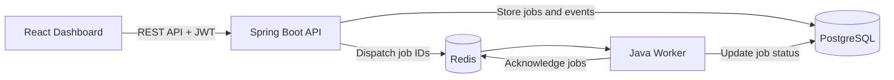

# QueueForge

QueueForge is a backend job processing system built using Java and Spring Boot. It allows users to submit jobs, schedule their execution, manage dependencies, and track their status.

Jobs are stored in PostgreSQL, while Redis is used to manage job delivery between the API and worker processes. Separate Java workers pick up jobs and execute them in the background.

The project also includes a React dashboard where users can submit jobs and monitor their progress, retries, and execution results.

## Architecture

QueueForge has three main parts:

- **Frontend:** Provides the dashboard for submitting and monitoring jobs.
- **Backend API:** Handles authentication, job creation, scheduling, and job management.
- **Worker:** Picks up available jobs and executes them in the background.

### Application flow

PostgreSQL stores the main job information and execution history. Redis helps coordinate job delivery between the API and workers.

## How QueueForge Works

The basic job processing flow is:

1. A user logs in and receives a JWT token.
2. The user submits a job through the dashboard.
3. The API validates the request and saves the job in PostgreSQL.
4. The scheduler checks which jobs are ready to execute.
5. Ready job IDs are added to Redis.
6. A worker picks up a job and processes it.
7. After execution, the worker updates the job status and saves the result.
8. If a job fails, it can be retried according to its configured retry settings.

QueueForge also supports job dependencies. A job can wait for another job to finish before it becomes eligible for execution.

### Job retries and recovery

Jobs can be configured with a maximum number of attempts and a retry delay.

If a worker stops unexpectedly while processing a job, the recovery mechanism checks for expired worker leases and allows eligible jobs to be processed again.

Redis may deliver the same job more than once. PostgreSQL row locking and job status checks help prevent multiple workers from claiming the same active job.

QueueForge uses **at-least-once delivery**, not exactly-once execution. If a worker performs an external operation but stops before saving its result, that operation could happen again during recovery. The included demo handlers do not perform external side effects.

The API and Redis do not share a distributed transaction. Periodic recovery helps dispatch jobs again if a failure happens between saving a job and publishing it to Redis.

## Technologies Used

- **Languages:** Java, C++, JavaScript, SQL
- **Backend:** Spring Boot, Spring Security, JPA/Hibernate, REST APIs, JWT Authentication
- **Frontend:** React, HTML5, CSS3
- **Database and Caching:** PostgreSQL, Redis
- **Tools:** Git, GitHub, Maven, Docker, Docker Compose

## Main Features

- User registration and login with JWT authentication.
- Submit and schedule background jobs.
- Track job status and execution history.
- Redis-based job delivery and coordination.
- Multiple worker processes for job execution.
- Job priority and dependency management.
- Configurable retry attempts and retry delays.
- Recovery of jobs after worker interruptions.
- Dashboard showing job statistics and worker activity.
- Support for different built-in job types.
- C++ REST API example for submitting jobs.

## Built-in Job Types

QueueForge currently includes four built-in job types.

| Job Type | Description |
|---|---|
| ECHO | Returns the submitted payload. |
| TRANSFORM | Converts text to uppercase and returns its length and processing time. |
| DELAY | Waits for a specified duration before completing. |
| SIMULATE_FAILURE | Simulates failed attempts before succeeding. |

### Demo account

If demo data is enabled in your local environment, you can use:

- **Email:** demo@queueforge.dev
- **Password:** QueueForge!2026

These credentials are intended only for local demonstration.

The backend tests cover job execution, retry handling, concurrent job claims, worker recovery, dependency failures, and execution event access.

## Current Limitations

- The API currently returns a maximum of 500 jobs.
- The execution event endpoint returns the latest 50 events.
- Retry delays are fixed rather than exponential.
- Worker recovery uses a fixed lease duration.
- The dashboard shows worker status and queue information but does not provide detailed CPU or memory monitoring.
- The system supports built-in job handlers rather than arbitrary user-defined code.
- Job delivery is at least once, so handlers involving external operations should use idempotency keys.

## Future Improvements

Some improvements that could be added in future versions:

- Server-side pagination for job history.
- More job types and configurable handlers.
- Better worker monitoring.
- Additional testing for failure and recovery scenarios.
- Improved job scheduling and retry options.

## Author

**Ashish Pagariya**

GitHub: https://github.com/ashuuakk06

---

QueueForge is a project built to understand how background job processing, queues, worker execution, and failure recovery work together in a Spring Boot application.
