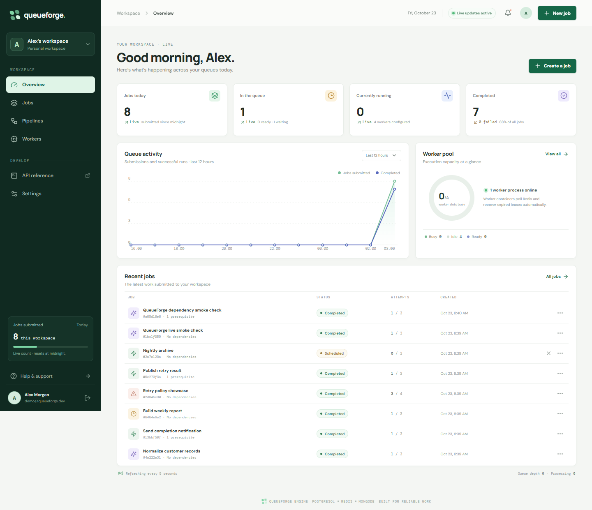
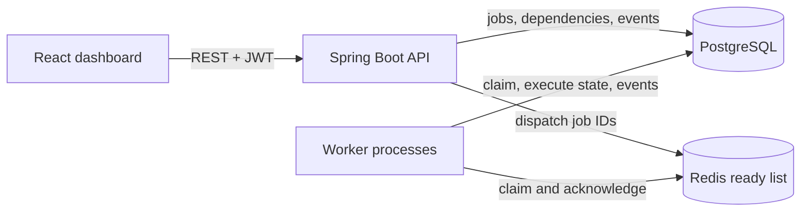

# QueueForge

QueueForge is a small distributed job processing system. An API accepts and schedules jobs, PostgreSQL stores their state, Redis coordinates delivery, and separate Java worker processes execute built-in handlers. The dashboard lets you follow jobs from submission through completion or failure.

## Dashboard



## Architecture



PostgreSQL is the source of truth for job state and execution history. Redis is a delivery and coordination layer. Flyway creates the schema, including indexed `job_events` rows, and Hibernate validates the mapped schema at startup.

### Job lifecycle

1. The dashboard sends a validated job request with a JWT. The API stores the job and its prerequisite links in PostgreSQL.
2. The scheduler checks due times and prerequisite states. Failed or cancelled prerequisites fail the dependent job. Ready job IDs are pushed to Redis in priority order.
3. A worker moves an ID from Redis's ready list to its processing list, then locks the PostgreSQL row. Only a `QUEUED` row can be claimed; the attempt count and running state are committed before execution begins.
4. The worker writes a result or error and an execution event. Failed attempts wait for the configured fixed delay and are dispatched again until the attempt limit is reached.
5. A recovery pass retries jobs whose two-minute worker lease expired and clears orphaned or no-longer-active entries from Redis's processing list. The scheduler also republishes queued jobs whose dispatch marker is older than one minute.

Redis messages can be delivered more than once. The row lock and state check prevent duplicate messages from claiming a job that is already running or finished. Queue delivery is **at least once**, not exactly once: a worker can stop after performing an external side effect but before saving its result, and recovery may run that work again. Attempt numbers fence stale workers from overwriting a later attempt, but they cannot undo side effects. Handlers that call external systems should use idempotency keys. The four included demo handlers have no external side effects.

The PostgreSQL update and Redis publish are not one distributed transaction. The dispatch marker and periodic recovery allow a queued job to be published again if the services fail between those operations; this favors eventual delivery and can create harmless duplicate Redis messages.

## Technology

- **Java 21 and Spring Boot** provide the REST API, validation, authentication, scheduling, and worker processes.
- **PostgreSQL** stores accounts, jobs, dependency edges, and execution events.
- **Redis** coordinates the ready and processing lists and stores worker heartbeats.
- **React, Vite, and Lucide** provide the responsive dashboard.
- **Docker Compose** runs the API, web app, database, Redis, and a separately scalable worker service.
- **C++20** has a small REST submission example in [examples/cpp-client](examples/cpp-client/README.md).

## Run locally

Requirements: Docker Desktop with Compose, plus Node.js 20.19+ and Java 21 if you want to run the frontend or backend outside Docker.

From the project directory:

```powershell
Copy-Item .env.example .env
# Replace POSTGRES_PASSWORD and JWT_SECRET in .env with local values.
docker compose up --build
```

Open [http://localhost:5173](http://localhost:5173). The API is at [http://localhost:8080](http://localhost:8080), and its health endpoint is [http://localhost:8080/actuator/health](http://localhost:8080/actuator/health).

The checked-in environment file contains placeholders, not production secrets. Compose requires both passwords to be set. PostgreSQL and Redis are only reachable on the Compose network; the web app and API ports are published for local use. To inspect PostgreSQL, use `docker compose exec postgres psql -U queueforge -d queueforge`.

Demo data is enabled in the copied local `.env` file. The local demo account is `demo@queueforge.dev` with password `QueueForge!2026`. Use it only for a local demo. Set `APP_DEMO_SEED=false` for other environments. The seeder creates its account and sample jobs only when that account does not already exist.

To stop the services and keep their data, run `docker compose down`. To remove local database and Redis data too, run `docker compose down -v`.

### Environment variables

| Variable | Purpose |
| --- | --- |
| `POSTGRES_DB` | Database name; defaults to `queueforge`. |
| `POSTGRES_USER` | Database user; defaults to `queueforge`. |
| `POSTGRES_PASSWORD` | Required database password. |
| `JWT_SECRET` | Required signing key of at least 32 bytes. |
| `APP_DEMO_SEED` | Seed the local demo account and jobs; `false` by default in Compose. |
| `APP_WORKER_CONCURRENCY` | Worker threads per worker process; defaults to `4`. |
| `APP_CORS_ALLOWED_ORIGINS` | Comma-separated browser origins; defaults to the local web and API origins. |

### Scale worker processes

The default worker service uses four threads per process. Start three worker containers with twelve total threads using:

```powershell
docker compose up --build -d --scale worker=3
```

The dashboard shows process IDs from worker heartbeats, configured slots, current running jobs, and Redis ready/processing depth. It does not claim per-thread CPU or memory measurements.

## Built-in job types

Job payloads must be JSON objects.

| Type | Example payload | Behavior |
| --- | --- | --- |
| `ECHO` | `{"message":"hello","source":"api"}` | Returns the payload as the result. |
| `TRANSFORM` | `{"text":"queueforge"}` | Returns the original text, uppercase text, character count, and processing time. |
| `DELAY` | `{"milliseconds":1500}` | Waits for up to 30 seconds and reports the elapsed duration. |
| `SIMULATE_FAILURE` | `{"failUntilAttempt":2}` | Fails the first two attempts, then succeeds. |

`maxAttempts` must be 1–10, `retryDelaySeconds` 1–3600, and `priority` 1–10. Higher priorities dispatch first among the currently due jobs. `runAt` accepts an ISO-8601 instant. `dependsOn` accepts UUIDs of existing jobs owned by the same account; a new job can only depend on earlier jobs, so the API cannot create a dependency cycle.

Example request:

```json
{
  "name": "Normalize customer data",
  "type": "TRANSFORM",
  "payload": { "text": "acme supply order 4821" },
  "maxAttempts": 4,
  "retryDelaySeconds": 10,
  "priority": 7,
  "dependsOn": []
}
```

## API

Register or sign in to receive a JWT:

```bash
curl -X POST http://localhost:8080/api/auth/login \
  -H 'Content-Type: application/json' \
  -d '{"email":"demo@queueforge.dev","password":"QueueForge!2026"}'
```

Send the returned token as `Authorization: Bearer <token>` to the protected routes:

| Method | Path | Description |
| --- | --- | --- |
| `GET` | `/api/auth/me` | Current account. |
| `GET` | `/api/dashboard` | Job counts, recent jobs, activity, Redis depth, and worker heartbeats. |
| `GET` | `/api/jobs?status=FAILED&search=import` | Latest 500 jobs for the account; optional status and text filters. |
| `POST` | `/api/jobs` | Create a job. |
| `GET` | `/api/jobs/{id}` | Read an owned job. |
| `GET` | `/api/jobs/{id}/events` | Read up to 50 newest events for an owned job. |
| `POST` | `/api/jobs/{id}/retry` | Retry a failed or cancelled job. |
| `POST` | `/api/jobs/{id}/cancel` | Cancel a job that has not started. |

The JavaScript dashboard sends these requests through the Nginx `/api/` proxy. The C++ example uses the same authenticated REST API.

## Tests and production build

Run backend tests from `backend` and the frontend production build from `frontend`:

```powershell
mvn test
```

```powershell
npm ci
npm run build
```

The backend tests cover execution results, retry and exhaustion transitions, duplicate and concurrent claims, stale worker fencing and recovery, failed dependencies, PostgreSQL-style event persistence, and account-level event access. Docker Compose builds the backend image without running the test suite; run `mvn test` separately when validating a change.

## Known limits

- The API returns at most the latest 500 jobs, and the event endpoint returns the latest 50 events. Server-side pagination is not implemented.
- Retry delay is fixed per job rather than exponential. Worker recovery uses a fixed two-minute lease and runs every 30 seconds.
- The dashboard reports process heartbeats and aggregate queue counts, not per-thread utilization or host resource metrics.
- The included handlers demonstrate processing behavior; QueueForge does not execute arbitrary user code or provide a production plugin system.
- Redis AOF is enabled for the local Compose service. PostgreSQL remains the authoritative store, and Redis/PostgreSQL failures can cause delayed retries and duplicate deliveries as described above.
